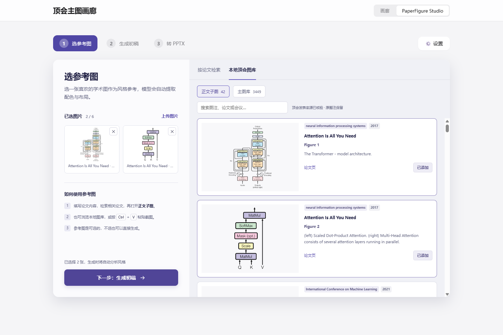
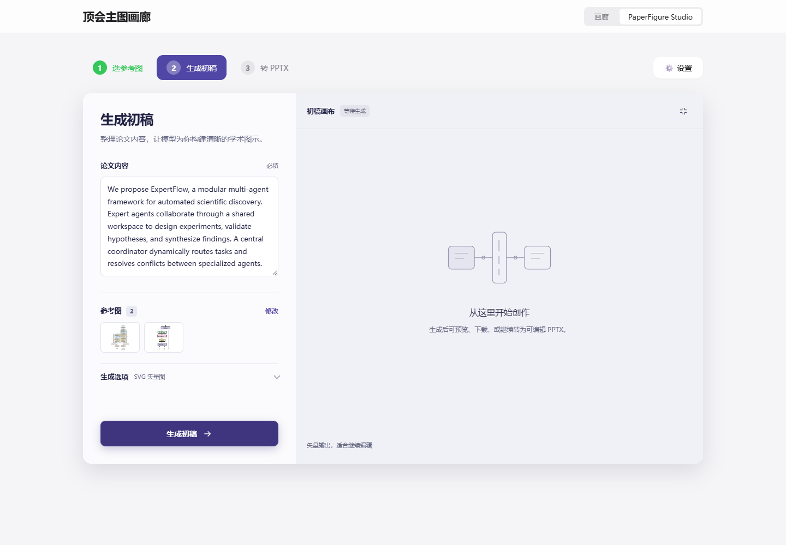
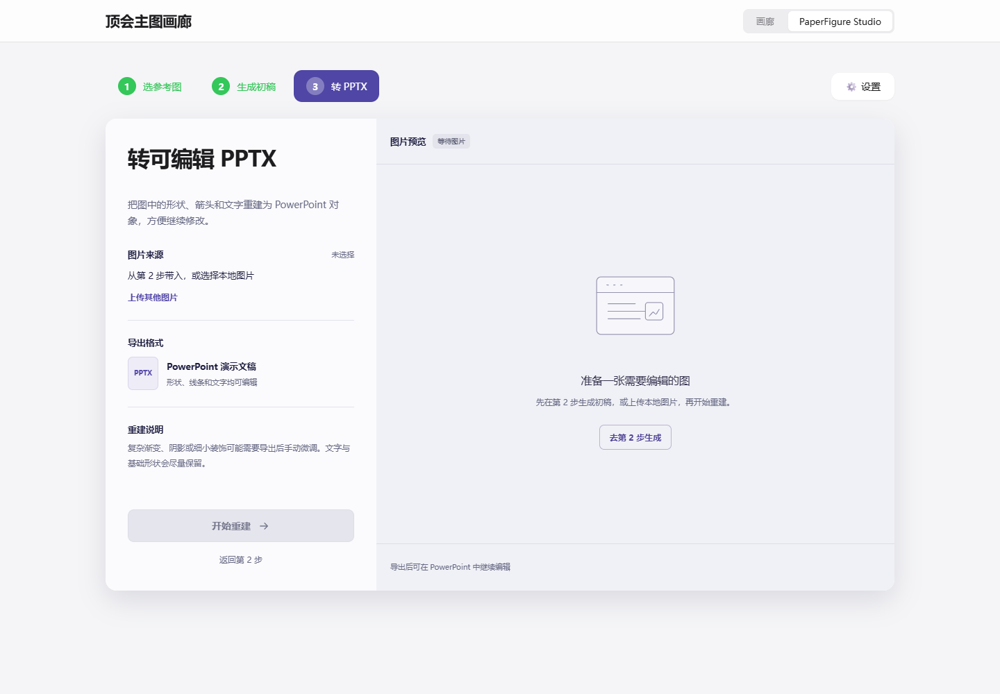

# PaperFigure Studio · 论文配图工作台

基于 React + TypeScript 的本地科研配图工具。根据论文内容检索相关论文、选择正文子图作为参考，生成 SVG 或位图，再重建为可编辑的 PowerPoint 图形。

> 本项目基于 [Top-Conf Figure Gallery](https://github.com/qwdwqfwq/topconf-paper-figure-gallery) 二次开发。原项目许可证与图片政策继续适用；论文图片版权归原论文作者及出版方所有。

## 功能

- **选参考图**：本地论文主图与精选正文子图；上传、拖入或 Ctrl+V 粘贴截图。
- **按论文内容检索**：使用用户配置的视觉模型提炼英文关键词，通过 OpenAlex 检索论文，必要时回退 arXiv；打开 arXiv HTML 后选择带图注的正文图片。
- **生成初稿**：填写论文内容，选择 SVG 或 AI 位图，使用自己的模型 API 生成。
- **转 PPTX**：将生成或上传的图片重建为可编辑 PowerPoint 对象，也可下载 SVG。
- 桌面端三步界面；API Key 仅保存在当前浏览器的 `localStorage`，不在源码中提供默认密钥。

## 界面预览

**1. 选择参考图**



**2. 根据论文内容生成初稿**



**3. 重建为可编辑 PPTX**



## 本地运行

需要 Node.js 20.19+ 或 22.12+。

```bash
npm install
npm run dev
```

打开终端显示的本地地址。点击「设置」，填写兼容接口地址、Key 及解析、生成、重建模型。

```bash
npm run build
npm run preview
```

**在线论文检索与 arXiv 图片代理由 Vite 开发服务器的同源中间件提供。`dist` 是纯静态文件，不包含这个服务端接口；要使用该功能，请运行 `npm run dev`。**

## 模型与接口配置

使用 OpenAI 兼容协议接入。启动项目后，点击右上角「设置」：

| 设置项 | 填写方法 |
|---|---|
| 服务商 | 选择「自定义 / OpenAI 兼容」 |
| 接入地址 | 填写服务的 OpenAI 兼容地址，例如 `https://api.openai.com/v1`，只填到 `/v1` |
| API Key | 填写该服务的 API Key |
| 解析模型 | 填写支持图片输入的模型 ID，用于提炼论文检索词和分析参考图风格 |
| 生成模型 | 填写用于生成 SVG 的模型 ID；留空则使用解析模型 |
| 重建模型 | 填写支持图片输入的模型 ID，用于生成可编辑 PPTX；留空则使用解析模型 |
| 图像模型 | 需要生成 AI 位图时，填写支持 OpenAI Images API 的图像模型 ID |
| 图像模型 API Key | 图像服务使用另一个 Key 时填写；留空则复用上面的 Key |

按需要配置：

- **生成 SVG**：填写接入地址、API Key、解析模型和生成模型。
- **生成 SVG 并转 PPTX**：再填写重建模型。
- **生成 AI 位图**：再填写图像模型。

API Key 保存在当前浏览器的 `localStorage`，不要写入源码或公开仓库。模型服务需允许浏览器跨域访问。

## 使用流程

1. **选参考图**：使用「按论文检索」或「本地顶会图库」，最多选择 6 张；也可以上传自己的图片。
2. **生成初稿**：填写论文内容，按需展开生成选项。选有参考图时会先分析其视觉风格，再生成初稿。
3. **转 PPTX**：使用第 2 步结果或上传图片，调用视觉模型重建并下载 PPTX。

本地子图库收录 7 篇经 OpenAlex 核验发表来源的论文、42 张正文图。arXiv 预印本会明确标识，不将其自动标为顶会论文。模型检索结果及发表信息应以原始论文页面为准。

## 主要目录

```text
src/                    React 界面、共享状态与模型调用
forge/                  生成请求、图片处理及可编辑 PPTX 重建模块
scripts/paper-search.mjs  OpenAlex / arXiv 同源检索与图片代理
assets/figures.js       本地论文主图索引
assets/subfigures.js    精选正文子图索引
images/                 论文图片，版权与许可见 IMAGES_POLICY.md
使用说明.md             详细中文使用说明
```

## 许可与来源

代码沿用原项目 MIT 许可证，详见 [LICENSE](LICENSE) 和 [NOTICE.md](NOTICE.md)。论文图片不包含在 MIT 许可内，详见 [IMAGES_POLICY.md](IMAGES_POLICY.md)。

OpenAlex、arXiv 的元数据和图片服务分别受其服务条款约束；原论文图片的版权许可独立于这些接口。使用模型生成图片需要用户自己的 API 额度。
